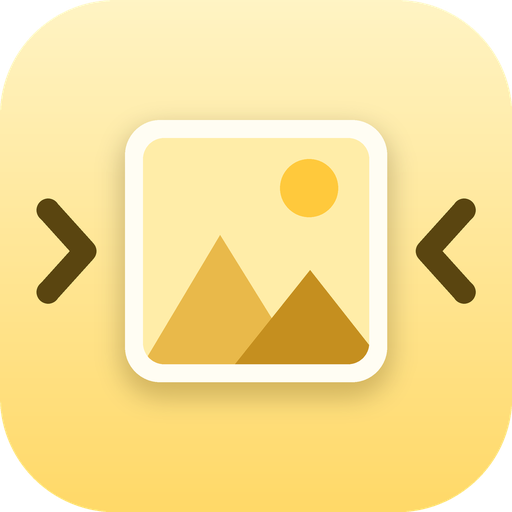

<div align="center">



# Hulagway

**Image Optimization and Conversion Studio**


</div>

Hulagway is a desktop app for compressing, converting, resizing, inspecting and comparing images. It is built for students, professionals and everyday users who want smaller files without losing quality, and it can process whole folders at once without freezing the window.

/Screenshot%202026-11-02%20111932.png?raw=true)
/Screenshot%202026-11-02%20111943.png?raw=true)
/Screenshot%202026-11-02%20111957.png?raw=true)
/Screenshot%202026-11-02%20112020.png?raw=true)
/Screenshot%202026-11-02%20112030.png?raw=true)
/Screenshot%202026-11-02%20112122.png?raw=true)


## Features

| Module | What it does |
|---|---|
| **Dashboard** | Storage saved, average reduction, totals, quick actions, recent operations and per-tool activity |
| **Image Compressor** | Compress JPG, PNG and WebP with an adjustable quality slider; shows original size, new size and percentage saved. Files that would not get smaller are skipped |
| **Format Converter** | Convert between PNG, JPG, WebP, BMP and TIFF. Transparency is kept where the format supports it and flattened onto a background colour you choose where it does not |
| **Image Resizer** | Resize by percentage, custom width and height, or presets (HD, Full HD, 4K, Instagram, X header and more), with aspect-ratio and "don't enlarge" options |
| **Batch Processor** | Add files or entire folders (with subfolders), then compress, convert and resize in one pass on parallel workers, with live progress, cancel, per-file error handling and a final summary |
| **Before & After** | Side-by-side view, 100% crop and an amplified difference map, with file sizes and a PSNR quality score. Generate a preview at any quality or compare two existing files |
| **Image Inspector** | Dimensions, format, colour mode, bit depth, transparency, DPI, ICC profile and EXIF/GPS metadata, plus a one-click metadata-free copy |
| **Processing History** | Every operation saved in SQLite; search, filter, compare, open the folder, delete entries or export to CSV |

### Built to be safe

- **Originals are never overwritten.** Outputs go to a separate folder with a suffix such as `_compressed`; if a name already exists, `_1`, `_2`, … is added.
- **Corrupted or unsupported files** are reported per file and never stop a batch.
- **The interface never freezes:** all processing runs in background threads and reports back through a thread-safe queue.
- **Settings are validated:** quality, dimensions and output paths are checked before anything runs.

## Getting started

### Requirements

- Python 3.9 or newer
- On Linux, Tk: `sudo apt install python3-tk`

### Installation

```bash
git clone https://github.com/<your-username>/hulagway.git
cd hulagway

# optional but recommended
python -m venv .venv
# Windows:      .venv\Scripts\activate
# macOS/Linux:  source .venv/bin/activate

pip install -r requirements.txt
python main.py
```

## Usage

1. Pick a tool from the sidebar (Compressor, Converter, Resizer or Batch).
2. Click **Add images** (or **Add folder** in Batch) and select your files.
3. Adjust the settings on the right and choose where to **save** the results.
4. Press **Start**. Double-click any finished row to open it in **Before & After**.

### Good to know

- **Quality** applies to JPG and WebP, and WebP at 100 is lossless. PNG is always lossless unless *Allow lossy PNG* is ticked, which reduces the palette (quality 1–99 maps to 16–256 colours).
- **Metadata** (EXIF, colour profile) is kept by default. Tick *Remove metadata* to strip it, including GPS location.
- **Animated images** are processed as their first frame only, and a note appears in the results.
- The default output folder is `~/Pictures/Hulagway`. History and settings are stored in `~/.hulagway/history.db`.

## Project structure

```
hulagway/
├── main.py                  # entry point
├── requirements.txt
├── assets/                  # logo.png, icon.ico and the script that draws them
├── core/                    # image logic, no GUI imports
│   ├── image_ops.py         # load, resize, convert, compress, inspect, compare
│   ├── batch.py             # ThreadPoolExecutor batch engine with cancel and summary
│   ├── database.py          # SQLite history and settings
│   └── utils.py             # formatting and file helpers
└── ui/                      # CustomTkinter interface
    ├── app.py               # main window and sidebar navigation
    ├── theme.py             # colour palette and styling
    ├── widgets.py           # shared components (cards, tables, previews, controls)
    ├── tool_page.py         # Compressor, Converter, Resizer and Batch
    ├── compare_page.py
    ├── inspector_page.py
    ├── history_page.py
    └── dashboard_page.py
```

The `core` package has no GUI dependencies, so the image engine can be tested or reused on its own.

## Tech stack

- **Python** with **CustomTkinter** for the interface
- **Pillow** for all image processing
- **SQLite** for processing history
- **threading** and **concurrent.futures** for background and batch work
- **pathlib** and **os** for file management

## Design

The interface follows the *Soft Yellow Daydream Hues* palette: Vanilla Tint `#FFF9E3`, Lemon Cream `#FFF6C1`, Butter Yellow `#FFEDA8`, Pale Honey `#FBE7A1` and Sunlight Glow `#FFE18A`, with dark brown text for readability. The logo is drawn in code: run `python assets/generate_logo.py` to regenerate `logo.png` and `icon.ico`.

## Build a Windows executable

```bash
pip install pyinstaller
pyinstaller --noconsole --onefile --name Hulagway --icon assets/icon.ico --add-data "assets;assets" --collect-all customtkinter main.py
```

The result is in `dist/Hulagway.exe`. On macOS and Linux, use `:` instead of `;` in `--add-data`.

## Author

**Joshua Arao** — Computer Science student, University of Science and Technology of Southern Philippines
