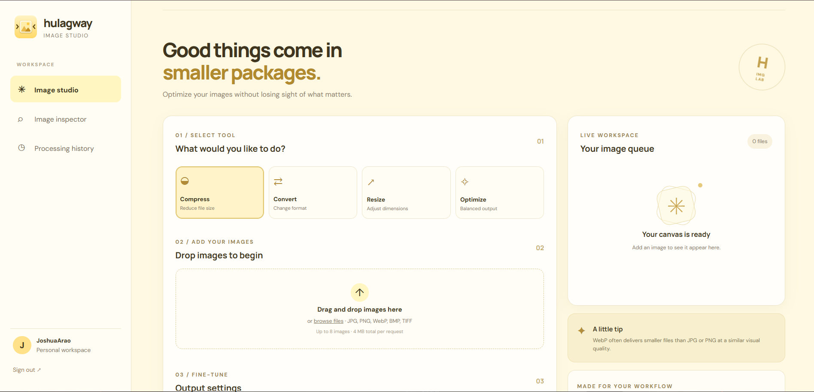
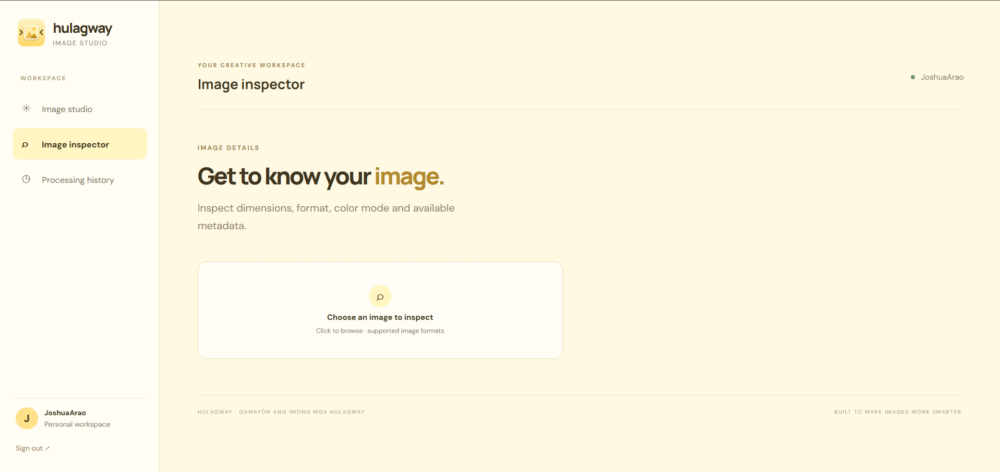

<div align="center">


# Hulagway

**Image Optimization and Conversion Studio**

*Make your images smaller.*


[Desktop Edition](#desktop-edition) · [Web Edition](#web-edition) · [Screenshots](#screenshots) · [Installation](#installation)

</div>

Hulagway is an image optimization and conversion studio for students, professionals, and everyday users. It helps make image files smaller, convert them into different formats, resize them, inspect their properties, and compare quality before and after processing.

The project has two editions: a full-featured **Python desktop application** and a separate **browser-based web application**. The web edition does not replace or remove the original desktop application.

## Editions

### Desktop Edition

The original desktop application is built with Python and CustomTkinter. It is designed for local image workflows, including folder-based batch processing and detailed image comparison.

**Desktop capabilities**
- Compress JPG, PNG, and WebP images with adjustable quality.
- Convert between PNG, JPG, WebP, BMP, and TIFF.
- Resize using dimensions, percentages, or presets.
- Process multiple images and folders in one batch.
- Compare before-and-after images, including a difference map and PSNR score.
- Inspect image dimensions, format, colour mode, transparency, DPI, ICC profile, and EXIF metadata.
- Keep a searchable local processing history in SQLite.

### Web Edition

**Open the live app:** [hulagway-joshy3.vercel.app](https://hulagway-joshy3.vercel.app)

The web edition lives in the `web/` directory and provides a responsive image workspace accessible from a browser.

- Username-based registration and login.
- Passwords stored as secure hashes.
- Image compression, conversion, resizing, and optimization.
- Image inspection for dimensions, format, colour mode, transparency, and available metadata.
- Account-specific processing history stored in Neon PostgreSQL.
- Batch processing for up to 8 images per request.
- Downloadable ZIP results.
- Responsive layout for desktop and mobile screens.

**Web stack:** Flask, Pillow, Neon PostgreSQL, and Vercel.

**Upload limit:** 4 MB total per request. The web service is configured with a maximum of 8 images per batch.

> The web deployment requires the `DATABASE_URL` and `SECRET_KEY` environment variables to be configured in the hosting platform. Never commit database credentials or secret keys to Git.

## Screenshots

The screenshots below show the **desktop edition**. The web edition has a simple three-box screenshot gallery where you only need to paste your image links.

### Web application

The web edition has three screenshot slots below. To add your screenshots, replace only each `PASTE_IMAGE_LINK_HERE` value with the direct image URL. You do not need to edit the captions or layout.

<table>
  <tr>
    <td align="center" width="33%">
      <strong>Image Studio</strong><br>
      
    </td>
    <td align="center" width="33%">
      <strong>Image Inspector</strong><br>
      
    </td>
    <td align="center" width="33%">
      <strong>Processing History</strong><br>
      
    </td>
  </tr>
</table>

### Desktop application


| Module | Description |
|---|---|
| **Dashboard** | Storage saved, average reduction, totals, quick actions, recent operations, and per-tool activity. |
| **Image Compressor** | Compress JPG, PNG, and WebP with adjustable quality. Displays original size, output size, and percentage saved. Files that would not become smaller are skipped. |
| **Format Converter** | Convert PNG, JPG, WebP, BMP, and TIFF. Transparency is preserved where supported or flattened onto a selected background. |
| **Image Resizer** | Resize by percentage, custom dimensions, or presets such as HD, Full HD, 4K, Instagram, and X header. Includes aspect-ratio and don't-enlarge options. |
| **Batch Processor** | Process individual files or folders, including subfolders, with progress updates, cancellation, per-file error handling, and a final summary. |
| **Before & After** | Side-by-side preview, 100% crop, difference map, file-size comparison, and PSNR quality score. |
| **Image Inspector** | Inspect dimensions, format, colour mode, bit depth, transparency, DPI, ICC profile, and EXIF/GPS metadata. |
| **Processing History** | Search, filter, compare, open output folders, delete entries, or export records to CSV. |

## Safety and file handling

- Original images are not overwritten. Processed files are saved separately with a descriptive suffix.
- Existing output filenames are protected by adding a numeric suffix.
- Unsupported or corrupted files are reported individually and do not stop an entire batch.
- Desktop image processing runs in background workers to keep the interface responsive.
- Metadata is retained by default in the desktop edition; users can choose to remove it, including GPS metadata.

## Installation

### Desktop edition requirements

- Python 3.9 or newer.
- Tk support on Linux (for example, `sudo apt install python3-tk`).

### Run the desktop application

```bash
git clone https://github.com/joshuaarao42-arch/HULAGWAY.git
cd HULAGWAY

python -m venv .venv

# Windows
.venv\Scripts\activate

# macOS / Linux
source .venv/bin/activate

pip install -r requirements.txt
python main.py
```

### Web edition

The web application source is in `web/`. See [`web/README.md`](web/README.md) for its configuration and deployment notes. The hosted version is available at [https://hulagway-joshy3.vercel.app](https://hulagway-joshy3.vercel.app).

## Desktop usage

1. Launch Hulagway and choose a tool from the sidebar.
2. Select images, or choose a folder in the Batch Processor.
3. Adjust the processing settings and output destination.
4. Start processing and review the results.
5. Open the Before & After view to compare output quality when needed.

### Desktop notes

- Quality settings apply to JPG and WebP. WebP at quality 100 is lossless.
- PNG is lossless by default. The optional lossy PNG mode reduces the colour palette.
- Animated images are processed as their first frame only.
- The default output folder is `~/Pictures/Hulagway`.
- Desktop history and settings are stored in `~/.hulagway/history.db`.

## Project structure

```text
HULAGWAY/
├── main.py
├── requirements.txt
├── assets/
│   ├── logo.png
│   ├── icon.ico
│   └── generate_logo.py
├── core/                  # Desktop image-processing logic
├── ui/                    # CustomTkinter interface
├── web/                   # Separate Flask web edition
├── docs/
│   └── screenshots/       # Screenshot guide and web screenshot template
└── Hulagway(Images)/      # Desktop application screenshots
```

The desktop `core/` package separates image-processing logic from the graphical interface, making the image engine easier to test and reuse.

## Technology

| Area | Technologies |
|---|---|
| Desktop interface | Python, CustomTkinter |
| Image processing | Pillow |
| Desktop history | SQLite |
| Desktop background work | threading, concurrent.futures |
| Web application | Flask, Pillow |
| Web database | Neon PostgreSQL |
| Web hosting | Vercel |

## Build a Windows executable

From the repository root:

```bash
pip install pyinstaller
pyinstaller --noconsole --onefile --name Hulagway --icon assets/icon.ico --add-data "assets;assets" --collect-all customtkinter main.py
```

The executable will be created in `dist/Hulagway.exe`. On macOS and Linux, use `:` instead of `; ` in the `--add-data` argument.

## Author

**Joshua C. Arao**  
Computer Science Student  
University of Science and Technology of Southern Philippines  
[GitHub](https://github.com/joshuaarao42-arch)

---

<div align="center">

Make your images smaller.

</div>
